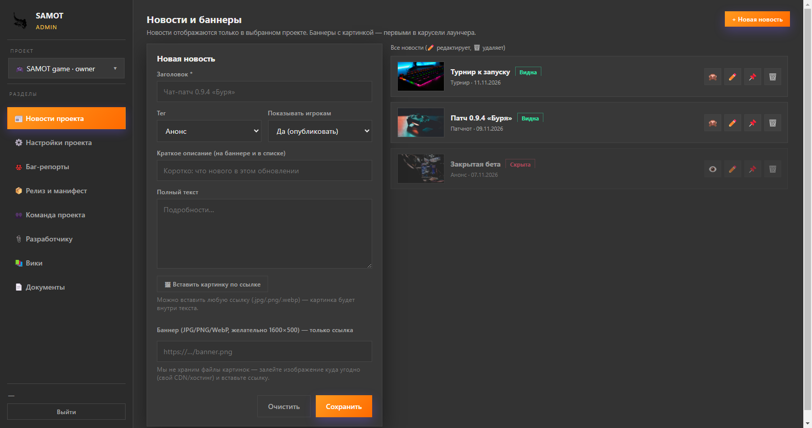

<p align="center">
  
</p>

<h1 align="center">SAMOT Admin</h1>

<p align="center"><b>Панель администратора и разработчика для SAMOT Launcher</b></p>

<p align="center">
  
  
  
  
</p>

---

## Что это

**SAMOT Admin** — рабочее место разработчика игры внутри SAMOT Launcher. Всё управление проектом — без SQL и кода: проект создаётся и выпускается из самого приложения.

## Возможности

### Управление проектом
- 🚀 **Проекты и роли**: создание проекта, владелец (`owner`) и редакторы (`editor`), приглашения по email
- 📰 **Новости и баннеры**: публикация, карусель на главной лаунчера, галерея скриншотов
- ⚙️ **Настройки проекта**: версии, тег релиза, мин. версия лаунчера, «показывать на Главной»
- 📊 **Аналитика**: активные устройства, запуски, новости за период, экспорт CSV
- ⛔ **Баны и разбаны** игроков + предупреждения проекта
- 📜 **Админ-лог**: кто и что делал в панели

### Выпуск игры
- 📦 **«📦 Релиз и манифест»**: тег, версия, вставка `manifest.json`, проверка релиза на GitHub в один клик
- 📎 **«Материалы для разработчиков»**: шаблоны изображений, инструкция по выпуску, кнопка «Скачать SAMOT Packager»
- 🧭 **Вики** прямо в приложении — справка по каждому разделу

### Автообновления
- 🔄 **«Обновления клиента»**: публикация новой версии лаунчера для игроков (чек-лист, версия, SHA-256, ноты)

## Скачать

| Что | Файл |
|---|---|
| **SAMOT Admin** | [SAMOT Admin Setup 1.0.0.exe](https://github.com/RevacholFrend/samot-admin/releases/download/v1.0.0/SAMOT.Admin.Setup.1.0.0.exe) |
| **SAMOT Launcher** (для игроков) | [SAMOT Launcher Setup 1.0.0.exe](https://github.com/RevacholFrend/samot-launcher/releases/download/v1.0.0/SAMOT.Launcher.Setup.1.0.0.exe) |
| **SAMOT Packager** (утилита сборки игры) | [SAMOT-Packager-1.0.0.exe](https://github.com/RevacholFrend/SAMOT-releases/releases/download/tools-v1.0.0/SAMOT-Packager-1.0.0.exe) |

> ℹ При первом запуске Windows SmartScreen может предупредить: сертификат самоподписанный.

## Скриншоты

<p align="center">
  
  
</p>

## Как выпустить свою игру

1. Попросите администратора добавить вас в проект (роль `owner` или `editor`).
2. Скачайте **SAMOT Packager** по ссылке выше → выберите папку игры → «Собрать релиз».
3. Прикрепите содержимое `game-dist/` к релизу на GitHub с тегом `vX.Y.Z`.
4. В этой админке → «📦 Релиз и манифест»: владелец, репозиторий, тег, версия, `manifest.json` → «Игра доступна для загрузки: Да».
5. Игроки получат игру по кнопке «Скачать игру» в лаунчере. Обновления — только изменённые файлы (SHA-256 + паки).

## Сборка из исходников

```bash
npm install
npm start          # запустить админку
npm test           # тесты
npm run dist       # собрать установщик (dist/SAMOT Admin Setup <version>.exe)
```

Требования: Windows 10+, Node.js LTS. Бэкенд — Supabase (схема и миграции — в репозитории [samot-launcher](https://github.com/RevacholFrend/samot-launcher)).

```
samot-admin/
├─ admin-main.js / admin-preload.js
├─ src/admin/          # интерфейс админки (вкладки, формы, вики)
├─ src/documents.js    # служебные документы (соглашение/ПД/правила)
├─ tools/packager/     # SAMOT Packager: сборка релиза игры
└─ tests/              # интегральные тесты и дымовой запуск
```

> Два репозитория держим синхронными по `src/config.js` и `src/documents.js` — при правках меняйте в обоих.

## Лицензия

MIT — см. [LICENSE](LICENSE).
